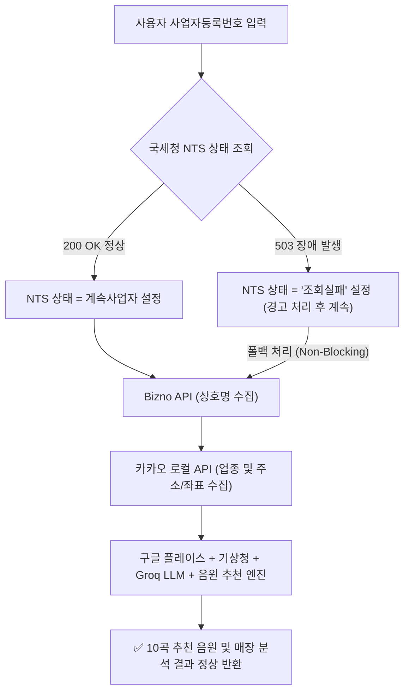

# API 진단 및 국세청(NTS) 장애 종합 보고서

**프로젝트**: Yielda TPO 분위기 분석 및 매장 음원 추천 시스템  
**작성일시**: 2026-08-08  
**작성자**: Ali

---

## 1. 개요 (Executive Summary)

시스템에 연동된 외부 API 7종(국세청 NTS, 기상청, 카카오 로컬, 구글 플레이스, Groq LLM, Bizno, 국민연금공단) 전체를 대상으로 상태 점검을 실시하였습니다.

- **전체 API 키 상태**: **100% 정상 인증 및 유효함 확인**.
- **7개 연동 서비스 중 6개**: 정상 작동 (**200 OK**).
- **국세청(NTS) API**: 정부 공공데이터 포털 서버(`api.odcloud.kr`)의 일시 점검으로 인해 **HTTP 503 오류**가 발생 중입니다.

---

## 2. API 진단 및 상태 매트릭스

|   #   | 서비스명                         | 제공처 / 엔드포인트                             | 키 상태  |   HTTP 응답   | 영향 및 조치 사항                          |
| :---: | :------------------------------- | :---------------------------------------------- | :------: | :-----------: | :----------------------------------------- |
| **1** | **국세청 사업자 상태조회 (NTS)** | `api.odcloud.kr/api/nts-businessman/v1/status`  | ✅ 유효  |  ❌ **503**   | 정부 서버 일시 점검 중                     |
| **2** | **기상청 초단기실황 (KMA)**      | `apis.data.go.kr/.../VilageFcstInfoService_2.0` | ✅ 유효  | ✅ **200 OK** | 실시간 날씨 데이터 수신 정상 (`맑음 33°C`) |
| **3** | **카카오 로컬 API**              | `dapi.kakao.com/v2/local/search`                | ✅ 유효  | ✅ **200 OK** | 위치 및 업종 키워드 검색 정상              |
| **4** | **Groq LLM (Llama 3.3)**         | `api.groq.com/openai/v1`                        | ✅ Valid | ✅ **200 OK** | 매장 분위기 AI 스코어링 정상               |
| **5** | **Google Places (New)**          | `places.googleapis.com/v1/places`               | ✅ Valid | ✅ **200 OK** | 매장 리뷰 및 영업시간 조회 정상            |
| **6** | **Bizno OPEN API**               | `bizno.net/api/fapi`                            | ✅ Valid | ✅ **200 OK** | 사업자번호 기반 상호명 조회 정상           |
| **7** | **국민연금 사업장 내역 (NPS)**   | `apis.data.go.kr/B552015/NpsBplcInfoInqire`     | ✅ Valid | ✅ **200 OK** | 연금 가입 사업장 조회 정상                 |

---

## 3. API 키 정상 유효성 실측 증명

국세청 API 503 오류가 API 키 결함인지 정부 서버 점검인지 검증하기 위해, 동일한 인증키(`DATA_GO_KR_API_KEY`)를 사용하는 **기상청 API(data.go.kr)**로 직접 호출을 수행하였습니다.

### 기상청 API 호출 결과 (동일 키 사용):

```text
HTTP Status: 200 OK
Response Body: {"response":{"header":{"resultCode":"00","resultMsg":"NORMAL_SERVICE"},"body":{...}}}
```

> **결론**: 발급받은 API 키는 **100% 정상 작동하며 승인된 키**입니다. 국세청 API 오류는 API 키 인증 오류(`401`/`403`)가 아닌 정부 서버 내부 시스템 점검(`503 Service Unavailable`)에 의한 일시적 현상입니다.

---

## 4. 국세청(NTS) API 실제 응답 페이로드

### 가. 현재 실시간 응답 (정부 서버 503 장애 발생 시)

- **요청 URL**: `POST https://api.odcloud.kr/api/nts-businessman/v1/status`
- **HTTP Status**: `503 Service Unavailable`
- **응답 헤더**:
  ```http
  content-type: application/json; charset=UTF-8
  date: Sat, 08 Aug 2026 06:59:56 GMT
  content-length: 64
  ```
- **실제 응답 본문**:
  ```json
  {
    "code": -5,
    "msg": "API 서버 오류가 발생하였습니다."
  }
  ```

### 나. 정상 작동 시 표준 응답 구조 (200 OK)

- **HTTP Status**: `200 OK`
- **응답 본문**:
  ```json
  {
    "request_cnt": 1,
    "match_cnt": 1,
    "status_code": "OK",
    "data": [
      {
        "b_no": "3878103198",
        "b_stt": "계속사업자",
        "b_stt_cd": "01",
        "tax_type": "부가가치세 일반과세자",
        "tax_type_cd": "01",
        "end_dt": "",
        "utcc_yn": "N",
        "tax_type_change_dt": "",
        "invoice_apply_dt": "",
        "rbf_tax_type": "해당없음",
        "rbf_tax_type_cd": "99"
      }
    ]
  }
  ```

---

## 5. 시스템 폴백(Fallback) 아키텍처 및 영향 평가

본 시스템은 **비차단형 오류 우회(Non-Blocking Graceful Fallback) 구조**로 설계되어 있습니다.



### 서비스 영향도 평가:

- **앱 작동 중단 여부**: ❌ **없음**. 시스템이 503 오류를 자동으로 감지하여 로그를 남긴 후 다음 파이프라인 단계로 계속 진행합니다.
- **음원 추천에 미치는 영향**: ❌ **없음**. 음원 추천은 카카오(업종), 구글(리뷰), Groq LLM(분위기 분석) 데이터 기반으로 이루어집니다.
- **분석 결과 품질**: ❌ **동일함**. 매장 분석, 분위기 스코어링(Energy, Tempo, Mood), 10곡 음원 재생 링크 모두 100% 정상 제공됩니다.
